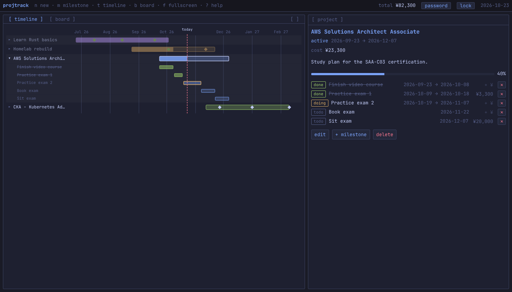
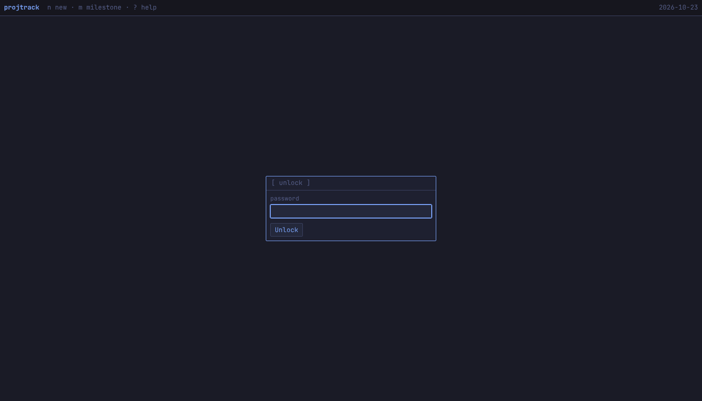
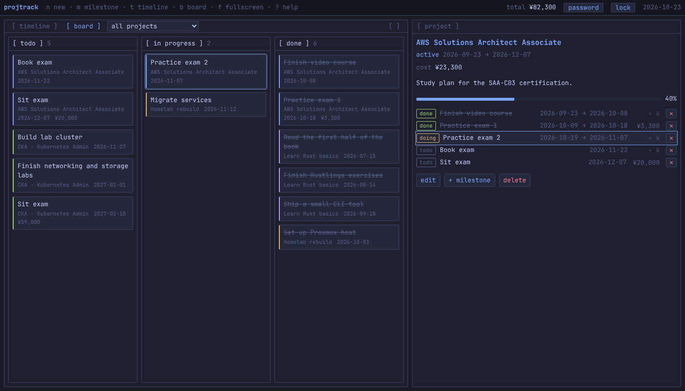
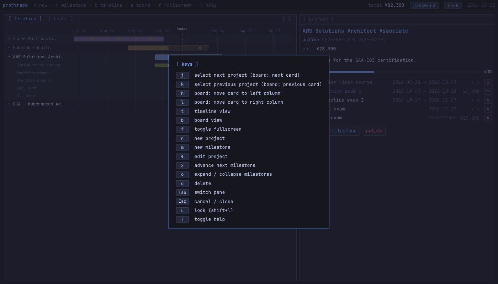

# projtrack

projtrack is a tracker for small projects such as certification study plans. Each project has a start and target date, a status, a color, and a list of milestones. The main view is a Gantt timeline or a kanban board of milestones, and a detail pane edits the selected project or milestone. It runs entirely in the browser as a static site, and the UI uses a Tokyo Night dark theme.



## Features

- Projects with a start and target date, a status, a color, and a list of milestones.
- Milestones with a due date, an optional start date, and an optional cost in JPY.
- Milestone costs are encrypted at rest, and the detail pane and top bar show per-project and total sums.
- Password lock: the app stays locked until you enter the password.
- Gantt timeline with expandable milestone sub-bars that show each milestone's span. In-progress milestones are yellow.
- Progress bars fill up to the due date of the latest done milestone, so the fill ends on that milestone's marker in the timeline.
- Milestone status (todo, doing or done) is set with the status pill in the detail pane. It replaces the old done checkbox.
- Kanban board with todo, in progress and done columns of milestones from all projects, a project filter, drag and drop, and fullscreen.

## Use it

Live at https://miloshkii.github.io/projtrack-web/

projtrack is a static, browser-only app. There is no server and no account. All data stays in this browser on this device (IndexedDB), so clearing site data deletes it and other browsers or devices do not see it. Use export to back it up.

### Run locally

```sh
python3 -m http.server -d web 8000
```

Then open http://127.0.0.1:8000. Any static file server works, and the app also works from a subpath such as `/projtrack-web/`.

## Password and encrypted costs

On first launch the app asks you to set a password (at least 8 characters). The password is stored only as a PBKDF2-SHA256 verifier. Milestone costs are in JPY and are encrypted with AES-GCM using a key derived from your password (PBKDF2-SHA256, separate salt). That key is held only in memory while the app is unlocked, so reloading the page locks it.



- Reloading the page or pressing `L` (Shift+L) locks the app.
- Use the `password` button in the top bar to change the password. Costs are re-encrypted with the new one.
- Forgetting the password is not recoverable. Use `forgot password` on the unlock screen (it asks for confirmation) to clear it and set a new one. Existing costs become unreadable; they show as `locked` and are not deleted.

## Backup

- `export` in the top bar downloads all data as a JSON file. Encrypted costs stay encrypted in the file, together with the salts and password verifier, so a backup restores with the same password.
- `import` replaces all current data with a backup file after a confirmation. The file is validated first, and the app locks afterwards so you unlock with the backup's password.

## Demo data

On an empty detail pane, `load demo data` adds sample projects and milestones. Projects whose name already exists are skipped.

## Board



The board shows the milestones of all projects in three columns: todo, in progress and done. Press `b` to open it and `t` to return to the timeline.

- Drag a card to another column or to a new place in a column. With a card selected, `h` and `l` move it one column left or right, to the end of that column.
- Use `j` and `k` to select the next or previous card. The project filter above the board shows one project's milestones only.
- Press `f` (or the `[ ]` button) to make the board fullscreen.

## Keyboard shortcuts

Keys typed into a form field are ignored, except `Esc`. Shortcuts with Ctrl, Cmd or Alt are ignored too.

| Key | Action |
| --- | --- |
| `j` / `ArrowDown` | Select next project (board: next card) |
| `k` / `ArrowUp` | Select previous project (board: previous card) |
| `h` / `ArrowLeft` | Board: move the selected card to the left column |
| `l` / `ArrowRight` | Board: move the selected card to the right column |
| `t` | Timeline view |
| `b` | Board view |
| `f` | Toggle fullscreen |
| `n` | New project |
| `m` | New milestone for the selected project |
| `e` | Edit selected project |
| `x` | Advance the first open milestone one status (todo, doing, done); reopens the last one when all are done |
| `o` | Expand / collapse the selected project's milestones |
| `d` | Delete selected project (asks for confirmation) |
| `Tab` | Switch focused pane |
| `Esc` | Close help, or exit fullscreen and cancel the open form |
| `L` | Lock (Shift+L) |
| `?` | Show or hide help |



## Development

```sh
node --test
```

Tests use Node's built-in runner (Node 26 or newer, no npm dependencies) against `web/localapi.js` with an in-memory store. PBKDF2 iterations are lowered in tests through the `iterations` option of `createApi`.

Pushing to `main` runs the tests and deploys `web/` to GitHub Pages (`.github/workflows/pages.yml`). Enable Pages with source "GitHub Actions" in the repository settings.

## Project layout

```
web/                 The whole site; deployed as is
  index.html         Page shell and help overlay
  app.js             UI state, detail pane and calls to the in-browser API
  localapi.js        In-browser backend: routes, validation, board ordering, auth, backup
  cryptoutil.js      PBKDF2 verifier and AES-GCM cost encryption (Web Crypto)
  storage.js         Storage interface: IndexedDB store and in-memory store
  demo.js            Sample data
  gantt.js           SVG Gantt timeline renderer
  board.js           Kanban board columns, cards and drag and drop
  auth.js            Unlock, set-password and forgot-password view
  dom.js             DOM, date and yen formatting helpers
  keys.js            Keyboard shortcuts
  style.css          Tokyo Night theme and layout
tests/               node --test suite (projects, milestones, board, auth, backup)
docs/screenshots/    README screenshots
.github/workflows/   GitHub Pages deploy
AGENTS.md            Operating rules for AI coding agents
CLAUDE.md            Claude Code project instructions (imports AGENTS.md)
.claude/agents/      Subagent definitions: coder, senior-coder, planner
```
